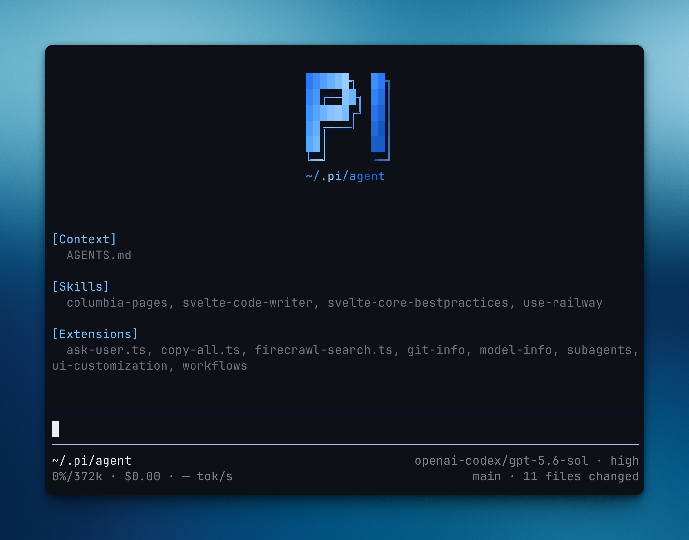

# my-pi-agent

An opinionated customization bundle for the [Pi Agent](https://github.com/nordeim/my-pi-agent) — themes, in-tree extensions, a curated 345-skill library, and the supporting docs an agent needs to bootstrap a fresh Pi installation into a productive engineering setup.

This setup is fairly opinionated. It:

- sets up GitHub Dark Default as the theme
- adds Firecrawl tools for searching and scraping
- updates the bottom bar to show the info the maintainer actually cares about
- adds background terminals + UI to manage them
- adds subagents to Pi
- adds workflows to Pi
- adds an ask-user tool that lets the model ask multiple-choice questions
- adds first-class `fd` (file discovery) and `rg` (content search) tools



---

## What's in the box 

| Area | Path | Description |
|------|------|-------------|
| Pi setup | `package.json`, `tsconfig.json`, `.env.example` | Runtime config, dependency manifest, env-var template for the Pi shell itself. |
| Extensions | `extensions/` | Twelve TypeScript extensions that plug into the Pi agent loop (see below). |
| Skills | `skills/` | 345 spec-compliant skill packages across 10 categories — the bulk of the repo by file count. Each skill is a self-contained folder shipping a `SKILL.md` whose YAML frontmatter (`name`, `description`, plus optional `license`/`author`/`version`) passes skill-spec validation, along with optional `references/`, `scripts/`, `scenes/`, `routes/`, or `engines/` subdirectories loaded on demand. See [`skills-inventory.md`](skills-inventory.md) for a full per-skill breakdown. |
| Themes | `themes/` | `github-dark-default.json` and `brutalist.json` — Pi UI color themes. |
| Git config | `git/` | Project-local gitignore patterns. |
| Assets | `assets/` | Screenshots referenced by this README. |
| Docs | `SETUP.md`, `AGENTS.md`, `APPEND_SYSTEM.md`, `Translation_Engine_v10_APPEND_SYSTEM.md` | Setup runbook, agent-onboarding brief, and system-prompt append layers. |

---

## Skills catalog

The skill library lives under `skills/` and is indexed by [`skills/skills-catalog.md`](skills/skills-catalog.md) — a single-file directory of all 345 skills with a one-line description and "when to use it" hint for each. Duplicating and obsolete skills are flagged in the catalog's [Duplicates & Obsolete Skills](skills/skills-catalog.md#duplicates--obsolete-skills) section. Only folders whose `SKILL.md` carries a skill-spec-compliant YAML header (`name` in lowercase letters/digits/hyphens matching the folder, `description` within the 1024-char limit) are indexed; the full inclusion criteria and exclusion list live in [`skills-inventory.md`](skills-inventory.md). The catalog is organized into 10 categories:

1. **Frontend Development & UI Engineering** — 71 skills (React 19, Next.js 16, Tailwind v4, Svelte 5, Vue 3/Nuxt, Astro 7, brutalist/avant-garde design systems, Sanity, e-commerce monorepo references, pixel-for-pixel web cloning, **prototype** (throwaway logic vs UI branching), **agent-browser** headless automation, **replicate-web-app** (REA-investigated web-app cloning), **web-app-foundation** (auth + dashboard + charts Next.js 16 foundation), **web-application** (the fuller generalized Next.js 16 engineering reference distilled from the same four sibling codebases) and its condensed companion **web-application-engineering** (see the duplicates note in the catalog), **htmx** (hypermedia frontend), **solidstart** (SolidStart 1 signals-based full-stack), **flutter** / **react-native-expo** / **tauri-2** (mobile & desktop), **ecommerce-website-scaffold**, **animate** (build an animation from scratch — purpose, tool, properties, curve, duration, interruption), **animate-expo** (React Native/Expo motion — gestures, sheets, haptics, screen transitions, motion off the JS thread), **apple-design** (Apple's fluid-interface principles translated for the web), **ask-sonner** (author-authored guide to the Sonner toast library), **emil-design-eng** (design-engineering craft philosophy for UI polish, component design, and animation decisions), **find-animation-opportunities** (find where a UI should animate — and where it shouldn't), **mobile-native** (make a web app feel native on a phone — sticky hover, 100vh, input zoom, safe areas), **pick-ui-library** (curated library picks for common frontend tasks), **write-swift** (modern Swift through 6.4 — value types, concurrency, generics, performance, Swift Testing), **animation-vocabulary** (reverse-lookup glossary from vague motion description to the exact term))
2. **Design Artifacts & Visual Creation** — 22 skills (image generation/edit/understand, video generation/understand, web-shader extraction, ComfyUI workflows, aesthetic design, kimi-docx/kimi-pdf/kimi-xlsx design-system document skills, **podcast-generate** (TTS podcast production), **pdf-old-20260806** (legacy pdf archive), **design-consultation** (researches your product and the landscape, then proposes a complete design system), **design-review** (designer's-eye visual QA — spacing, hierarchy, AI-slop patterns, slow interactions — then fixes them), **design-shotgun** (generate multiple AI design variants, compare on a board, iterate on structured feedback), **diagram** (English or mermaid source → editable excalidraw + rendered SVG triplet))
3. **Full-Stack & Backend Development** — 24 skills (Django 6, API patterns, Python patterns, framework templates, n8n workflow automation, PowerShell, security hardening, TrustSkill, **wizard** (interactive bash wizard scaffolding), **react19-vite-spa-fastify-drizzle-sqlite** (React 19 Vite SPA + Fastify + Drizzle SQLite monorepo), backend framework family (**dotnet-9**, **fastapi-sqlalchemy**, **fastify**, **go-web**, **hono**, **keystonejs-6**, **nestjs**, **phoenix-1-7**, **rails-8**, **rust-web**, **spring-boot-3**))
4. **AI / ML / Multimodal SDK Skills** — 17 skills (LLM, web search, web reader, browser automation, AMiner academic search, **aminer-deep-search** (host-model-driven multi-round survey-grade paper collection), Microsoft Foundry, mac-mlx local inference, auto-target tracking, **asr** / **tts** / **vlm** (speech & vision SDK skills, now spec-compliant lowercase), **ai-news-collectors**, **aminer-free-academic**)
5. **Testing, QA & Performance** — 40 skills (TDD, **tdd** (seam-based red-green), **diagnosing-bugs** (tight red feedback loop), **code-review** (two-axis Standards and Spec), webapp testing, Playwright CLI, Chrome DevTools MCP, **before-and-after** (visual-diff screenshots), **full-page-screenshot** (quality-gated full-page PNG captures), **evidence-driven-testing** (recorded test evidence posted to PRs), **principle-prove-it-works** (verify the real artifact before declaring done), **principle-test-behavior-not-implementation** (assert observable behavior, not internals), **benchmark-checklist** (vet a perf measurement before acting on it), **create-verification-skill** (generate a project-local driver/verify skill), **principle-explain-the-number** (find what a measured number actually measured), **qa** (fix browser/API/CLI/job/worker/webhook bugs end to end), **test-audit** (find low-value or duplicate tests and the test-only code they keep alive), **eval-plan** (preregister evals — bars, arms, decoys, stop rules — then spend-gate a priced pilot), performance optimization, **animation-performance** (keep animations inside the frame budget — composite-only properties, motion off the main thread, `will-change`), **break-ui** (break UI with worst-case data — long names, huge counts, empty lists — then fix what breaks), **improve-animations** (codebase-wide animation audit producing prioritized, self-contained fix plans))
6. **Code Quality, Security & Architecture** — 55 skills (code review and audit, **codebase-design** (deep modules vocabulary), **improve-codebase-architecture** (HTML deepening report), **setup-ts-deep-modules** (dependency-cruiser boundaries), **architect** (sketch types before code), **how** (subsystem walkthroughs and placement), **deslop** (AI code-slop removal), **blast-radius** (pre-ship "what else could this break" scan), **principle-fix-root-causes** / **principle-guard-the-context-window** / **principle-build-the-lever** / **principle-laziness-protocol** / **principle-sequence-verifiable-units** / **principle-never-block-on-the-human** / **principle-foundational-thinking** / **principle-subtract-before-you-add** (auto-invoked engineering principles), **correct** (make repeated agent mistakes impossible), **why** (cited design-rationale discovery), **thermo-nuclear-review** / **thermo-nuclear-code-quality-review** (extremely strict branch audits), **principle-attack-the-premise** / **principle-boundary-discipline** / **principle-make-operations-idempotent** / **principle-minimize-reader-load** / **principle-model-the-domain** (auto-invoked engineering principles), **review** (pre-landing PR review with specialist checklists and gate integrity), **investigate** (systematic root-cause debugging), **careful** / **guard** (destructive-command guardrails; full safety mode with directory-scoped edits), **freeze** / **unfreeze** (restrict edits to a directory for the session, then release), **cso** (security audit — static findings, reproduction, repair candidates), **devex-review** (live developer-experience audit), **deslop-shared-libs** (find worthwhile shared-code extractions in recent work), **review-animations** (strict motion review against a high craft bar — default to flagging, approval earned), vulnerability scanning, encrypt/decrypt, clean-code, **code-structure** (deduplicating operational logic), **greploop** / **greploop-apps** (Greptile-driven PR improvement loops), git guardrails, pre-commit setup, **ponytail** (minimal-diff coding methodology))
7. **Planning, Workflow & Project Management** — 54 skills (spec-driven development, **to-spec** (conversation synthesis), **to-tickets** (tracer-bullet blocking edges), **wayfinder** (decision-ticket map), **implement** (per-ticket tdd and code-review), **implement-spec** (whole-spec task-graph implementation with parallel subagents), **pr** (PR body: smallest visual, before/after evidence, merge danger), **make-pr-easy-to-review** (clean history and reviewer guidance), **fix-ci** (red checks to green), **fix-merge-conflicts** (non-interactive resolution), **get-pr-comments** (review-comment fetch), **poteto-mode** (agent style with 23 playbooks), **figure-it-out** (auditable playbook when no narrower one fits), **show-me-your-work** (reviewable decision trail for unattended work), **recall** (reconstruct working context into a resume brief), **retro** (session retrospective → environment improvements), **spec** (turn vague intent into a precise, executable spec in five phases), **ship** (detect base branch, run tests, review diff, bump VERSION, update CHANGELOG, commit, push, create PR), **context-save** / **context-restore** (persist working context and restore it in a later session), **learn** (manage project learnings), **plan-ceo-review** / **plan-eng-review** / **plan-design-review** / **plan-devex-review** (CEO/founder-, eng-manager-, designer's-eye-, and DX-lens plan reviews), **office-hours** (YC office hours — evaluate whether an idea is worth building before writing code), **triage** (five-role state machine), **grill-with-docs** (stateful grilling with ADR capture), **grilling** (relentless interview primitive), **grill-me** (stateless grilling), **chief-of-staff** (long-running goals via coordinated subagents and wiki memory), **new-feature** (git worktree task isolation), plan-writing, incremental implementation, git workflow, CI/CD, shipping, orchestrator-toolkit, loop-builder, subagents, background terminals, context engineering)
8. **Documentation & Content Creation** — 39 skills (README/CLAUDE/AGENTS.md generation, **writing-for-agents** (context pointers and progressive disclosure), **writing-fragments** (mine raw fragments, explore), **writing-shape** (shape raw material into an article, exploit), **writing-beats** (grounded beat-by-beat article journeys), **technical-writing** (Diátaxis / Google style / STE layered standard), **domain-modeling** (GLOSSARY.md and ADR sharpening), **research** (cited primary-source capture), **research-explorer** (vague direction → scored candidate topics with pre-survey), **literature-survey** (PDF survey with LaTeX source and taxonomy figures), **experiment-suite** (design doc + runnable code + figures + report experiment packages), **handoff** (pointer-based session compaction), **markdown-to-html** (polished single-file web rendering), **officecli** (Office documents via CLI), **unslop** (cut AI tells from prose), **humanizer**, pptx/docx/pdf/xlsx document families, cheat-sheet, storyboard manager, pandoc-docx-template, **qingyan-research** (research reports), **translation-engine** (forensic CN↔EN translation), **document-generate** (generate missing documentation for a feature, module, or project from scratch), **document-release** (release documentation audit), **make-pdf** (turn any markdown file into a publication-quality PDF))
9. **Career, Learning & Personal Development** — 12 skills (resume builder, JD-resume tailor, idea refinement, study aids, quiz skills, mindfulness, dream interpreter, **gaokao-collect-student-info** / **gaokao-fetch-volunteers** / **gaokao-recommend-majors** / **gaokao-recommend-schools** / **gaokao-generate-report** — 5-step Chinese college-entrance-exam志愿填报 pipeline)
10. **DevOps, Infrastructure & External Integrations** — 11 skills (multi-search-engine, rootless PostgreSQL, skill discovery and authoring meta-skills (**using-agent-skills**, **template-skill**, **skill-finder-cn**), visual-design foundations, web-design guidelines, task review, **land-and-deploy** (land-and-deploy workflow: merge base, tests, deploy pipeline), **how-to-git-push-using-ssh-wrapper** (SSH-key push automation))

Each skill folder contains a `SKILL.md` with a spec-compliant YAML header (`name`, `description`, and optional `license`/`author`/`version`) and the full workflow instructions. Most skills also ship `references/`, `scripts/`, or `scenes/` subdirectories that the `SKILL.md` loads on demand.

---

## Extensions

Twelve TypeScript extensions under `extensions/` extend the Pi agent loop. Each one is a self-contained package with its own `package.json` and `tsconfig.json`.

| Extension | Purpose |
|-----------|---------|
| `ask-user` | Lets the model ask the user multiple-choice questions instead of guessing. |
| `ava-agent` | Ava autonomous agent harness with session-graph, AST auditor, and reflect-session tooling. |
| `background-terminals` | Run and manage long-lived shell commands (dev servers, watchers, streaming builds) in background terminals. |
| `copy-all` | Bulk-copy agent output to the clipboard. |
| `file-search` | First-class `fd` (file discovery) tool wired into the agent loop. |
| `firecrawl-search` | Firecrawl-powered web search and scraping tool. |
| `git-info` | Surface git status, changed files, and refresh-coordination in the Pi UI. |
| `model-info` | Display model metadata in the bottom bar. |
| `summaries` | Generate and surface session summaries inside the agent transcript. |
| `subagents` | Headless autonomous sub-agents (Pi, Claude, Codex harnesses) with their own context window. |
| `ui-customization` | Customize Pi UI chrome (bottom bar, panels, status indicators). |
| `workflows` | Multi-step workflow runner with sandboxing, artifacts, serialization, and a dashboard view. |

---

## Themes

Two Pi UI themes ship in `themes/`:

- `github-dark-default.json` — the default dark theme modeled on GitHub's dark palette.
- `brutalist.json` — a raw, high-contrast brutalist alternative.

Switch between them via Pi's theme selector.

---

## Setup

### On your own Pi

Instructions for installing this bundle on a fresh Pi are in [`SETUP.md`](SETUP.md). The short version: clone the repo, copy `themes/*.json` into Pi's themes directory, symlink the extensions you want into Pi's `extensions/` directory, and restart Pi.

### For agents

If you are an agent reading this, onboarding instructions are in [`AGENTS.md`](AGENTS.md). System-prompt append layers live in [`APPEND_SYSTEM.md`](APPEND_SYSTEM.md) and [`Translation_Engine_v10_APPEND_SYSTEM.md`](Translation_Engine_v10_APPEND_SYSTEM.md) — read them in order before operating in this repo.

### Skills

Skills are loaded on demand by the Pi agent loop. To make a skill available, ensure its folder is present under `skills/` (it already is, if you cloned this repo) and that Pi's skill discovery is pointed at `skills/`. To find the right skill for a task, start at [`skills/skills-catalog.md`](skills/skills-catalog.md).

---

## Repository layout

```
my-pi-agent/
├── assets/                    # Screenshots and images
├── extensions/                # 12 TypeScript extensions to the Pi agent loop
├── git/                       # Project-local gitignore patterns
├── skills/                    # 345 skill packages (see skills/skills-catalog.md, **analyzing-us-bigtech-stocks** (full-pipeline big-tech stock-move RCA: audited fact base, hypothesis tree, IC deck), **big-tech-earnings-postmortem** (lightweight post-earnings root-cause note), **bigtech-equity-research** (quantified single-note equity research with segment variance and math helpers))
├── themes/                    # github-dark-default.json, brutalist.json
├── AGENTS.md                  # Agent onboarding brief
├── APPEND_SYSTEM.md           # System-prompt append layer
├── README.md                  # This file
├── SETUP.md                   # Pi-side installation runbook
├── Translation_Engine_v10_APPEND_SYSTEM.md
├── package.json               # Pi runtime dependencies
├── tsconfig.json              # TypeScript config for extensions
└── .env.example               # Environment variable template
```

---

## License

The Pi setup code in this repo is provided as-is for the maintainer's personal use. Individual skills under `skills/` ship their own licenses — see each skill's `LICENSE.txt` and `SKILL.md` frontmatter for terms.
